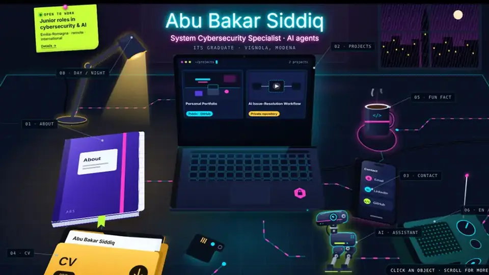

# abus1dd.github.io

Personal portfolio of **Abu Bakar Siddiq**, System Cybersecurity Specialist (ITS Academy Olivetti, 2026), open to junior roles in cybersecurity and AI.

**Live:** https://abus1dd.github.io/



## The Desk

The site is an interactive top-down desk: every object is a section, and clicking one zooms the camera in.

| Object | Section |
|---|---|
| Notebook | About |
| Laptop | Projects, with a working terminal (`help`, `whoami`, `projects`, `cat case-study`…) |
| Phone | Contact: Email, LinkedIn, GitHub |
| CV folder | CV download (PDF, in Italian) |
| Mug | A random fun fact |
| Robot | AI assistant that answers questions about Abu |
| Lamp / radio | Day-night theme / English-Italian |
| Plant, calendar, keyboard | Skills, journey, certifications (revealed by scrolling) |
| Security key | Root access: plug it into the laptop, touch to verify, then `security-report` or `xray` (blueprint mode) |

Recruiters in a hurry get a plain menu, a skip link and a text version of every section. Phones get a card layout, and browsers without graphics acceleration get a light version automatically.

## Projects featured

- **AI Issue-Resolution Workflow** (private repository, in production): an AI agent resolves labelled GitLab issues in an offline Docker sandbox, must pass all tests, and opens a merge request for human review. Case study on the site.
- **This portfolio**: case study and security write-up on the site.

## Security

- Content Security Policy: only the site's own scripts (inline script allowed by its hash) and the analytics script run.
- Libraries are self-hosted in `assets/js/`; no third-party CDN.
- Cookie-free analytics (GoatCounter).
- The AI assistant (`worker/`) runs on Cloudflare Workers AI with an origin allowlist, per-visitor rate limits, server-side facts and prompt-injection defences, and falls back to scripted answers.

## Repository layout

| Path | Purpose |
|---|---|
| `src/desk.html` | Source of the site: edit this |
| `tools/build.py` | Builds `index.html` from the source (minifies the script, writes the CSP hash) |
| `index.html` | The built site served by GitHub Pages: do not edit by hand |
| `404.html` | Themed not-found page |
| `assets/` | CV, project video and poster, images, self-hosted GSAP |
| `worker/` | Cloudflare Worker for the AI assistant ([setup](worker/README.md)) |
| `PROGRESS.md` | Decisions, status and open items |

## Editing

```bash
# 1. edit src/desk.html
python tools/build.py          # 2. rebuild index.html (needs Python 3; Node.js for minifying)
git add -A && git commit -m "..." && git push
```

After changing the assistant's facts in `worker/src/index.js`:

```bash
cd worker
npx wrangler deploy
```

## Hosting

Served by GitHub Pages from the root of `main`. Work happens on `redesign/animated-portfolio`; pushing to `main` redeploys the site.

## Built with

HTML, CSS, SVG and JavaScript, [GSAP](https://gsap.com) 3.12.5, Cloudflare Workers AI, GitHub Pages. Built with an AI coding assistant (Claude), directed and reviewed by Abu.

## Contact

- Email: abubakarso2004@gmail.com
- LinkedIn: https://www.linkedin.com/in/abu-bakar-siddiq-/
- GitHub: https://github.com/abus1dd
